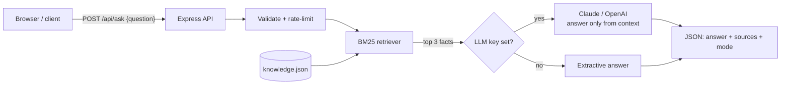

# AI Portfolio Assistant

A small **Node.js + Express** service that answers recruiters' questions about me, **A Mohamed Sahul Hameed** (Senior Full Stack Developer, Chennai), using **retrieval-augmented generation (RAG)**.

- **Live in-browser version:** [sahulhameed-developer.github.io/portfolio/#assistant](https://sahulhameed-developer.github.io/portfolio/#assistant)
- **Portfolio:** [sahulhameed-developer.github.io/portfolio](https://sahulhameed-developer.github.io/portfolio/)

## How it works



1. **Knowledge base** – `knowledge.json` holds short, factual chunks (skills, experience, projects, availability).
2. **Retrieval** – `retriever.js` is a dependency-free BM25 ranker with synonym normalisation (`node.js → node`, `llm → ai`). The same file runs in Node *and* in the browser.
3. **Generation (optional)** – `llm.js` sends the top facts to Claude or OpenAI with a grounded system prompt ("use only the context"). With no API key it falls back to an extractive answer, so the demo always works.
4. **API hygiene** – JSON body size limit, input validation, per-IP rate limiting, CORS, and graceful fallback when the LLM call fails.

## API

| Method | Path          | Body                       | Response                                  |
|--------|---------------|----------------------------|-------------------------------------------|
| GET    | `/api/health` | –                          | `{ status, docs, uptime }`                |
| POST   | `/api/ask`    | `{ "question": "..." }`    | `{ answer, sources[], mode }`             |

```bash
curl -s localhost:3000/api/ask -H 'content-type: application/json' \
  -d '{"question":"What is his notice period?"}'
```

## Run locally

```bash
npm install
cp .env.example .env   # optional: add ANTHROPIC_API_KEY or OPENAI_API_KEY
npm start              # http://localhost:3000
npm test               # node:test – retriever + API tests
```

## Tech

Node.js 18+, Express 4, native `fetch`, `node:test`. No database or vector DB needed at this size; swapping BM25 for embeddings + a vector store is a drop-in change in `retriever.js`.

## Contact

[LinkedIn](https://www.linkedin.com/in/mohamed-sahul-hameed-372262117/) · mhedsahul@gmail.com
